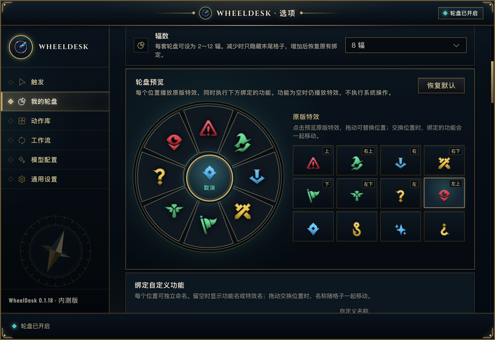
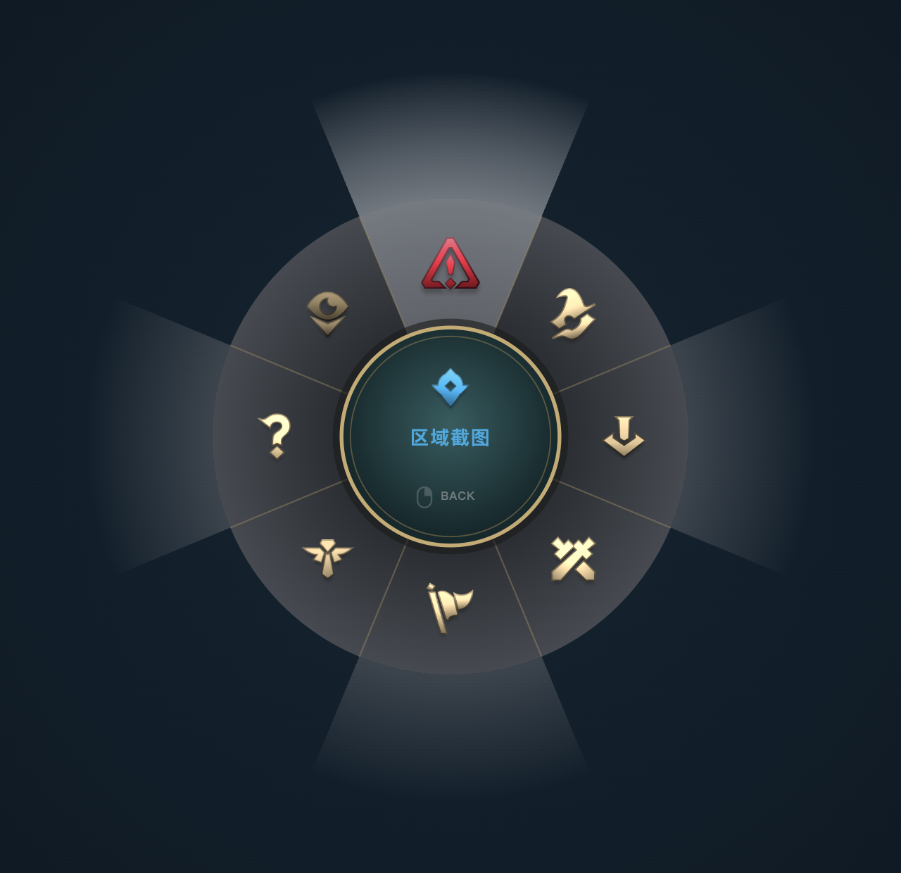
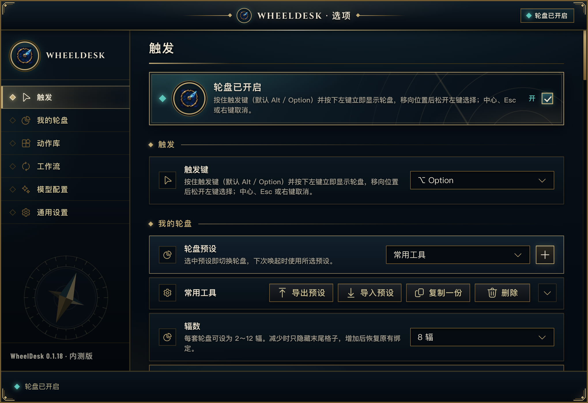
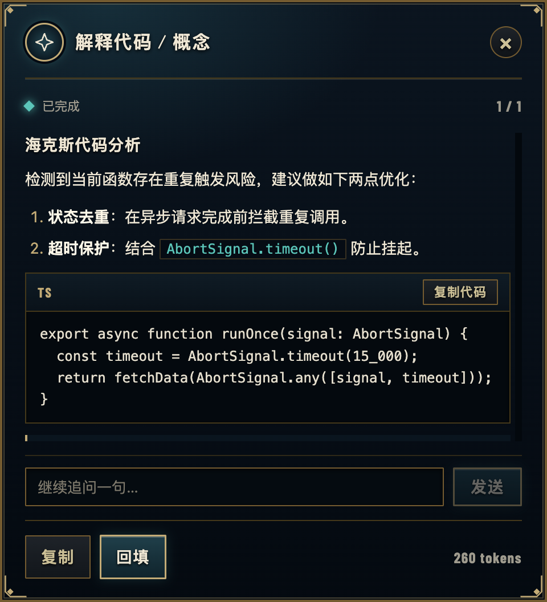

# WheelDesk

[简体中文](README.zh-CN.md) · [Download Latest Release](https://github.com/Alooshy0827/WheelDesk/releases) · `v0.1.19`

A desktop action wheel styled 1:1 after the **League of Legends in-game Options & Smart Ping Wheel** for everyday system actions, bring-your-own-key AI instructions, and local workflows. Hold `Alt` (`Option` on macOS) and press the left mouse button to open the wheel immediately; flick to a slot and release to run; return to center, press `Esc`, or right-click to cancel.

Based on [lolPing](https://github.com/darrenprx/lolPing) (`c97fe772b98514b83f011ee540601faabd066d23`). The MIT source license and original attribution are preserved; the separate Riot Games media attribution remains in [LICENSE](LICENSE) and [NOTICE.md](NOTICE.md). Emotes and room features are not included.

---

## Screenshots

| 1:1 League In-Game Wheel Editor | Desktop Smart Ping Wheel Overlay (2–12 Spokes) |
| :---: | :---: |
|  |  |

| In-Game Options Shell (Preset Export / Import) | Hextech AI Result Modal (Markdown · Code Copy · Follow-Up) |
| :---: | :---: |
|  |  |

---

## Highlights

- **1:1 League of Legends In-Game UI & Audio**: Authentic dark Hextech & aged-brass ESC Options frame, four SVG corner ornaments, square brass checkboxes, diamond-thumb sliders, offline SIL OFL 1.1 `Cinzel` & `Barlow Condensed` typography, and 10 loudness-calibrated `rcp-fe-lol-uikit` interaction sound effects synced with global volume and mute. See [UI Design Spec](docs/ui-design-spec.md).
- **Original Ping Effects Decoupled from Functions**: Preserves hover glow/scale, expanding rings, pop/bobbing, All In collision, and original audio. Supports multiple wheels with 2–12 spokes and independent custom slot names.
- **One-Click Wheel Preset Export / Import**: Share any wheel along with its referenced actions and workflows as a `.wheeldesk.json` bundle — **model profiles and API keys are never exported**. Imports remap colliding IDs safely without overwriting existing presets.
- **Mouse-Native Default Actions**: Out-of-the-box region capture, screenshot Q&A, screenshot OCR, screenshot translation, ZH/EN translation, writing polish, key-point summary, code/concept explanation, plain-text paste, and folder opening — plus custom apps/paths, URLs, shortcuts, clipboard ops, and local scripts.
- **Hextech Streamed Result Modal**: Non-focus-stealing streaming answers with **sanitized Markdown rendering**, **one-click code-block copy**, **in-card multi-turn follow-up questions**, and guarded fill-back to the original window.
- **Custom AI Actions & Linear Workflows**: Works with OpenAI-compatible, Anthropic, and local (Ollama / LM Studio) endpoints. Describe an AI action once to cache an editable reusable instruction, or chain actions and macOS Shell / Windows PowerShell scripts (stdin-fed) into workflows.
- **Local-First Privacy**: English and Simplified Chinese UI, OS-encrypted API keys (`secrets.enc`), zero accounts, telemetry, or cloud sync.

---

## Install

Download installers from [GitHub Releases](https://github.com/Alooshy0827/WheelDesk/releases):

### macOS 13+ (Apple Silicon)
1. Open `WheelDesk-0.1.19-arm64.dmg` and drag `WheelDesk.app` into **Applications**.
2. Builds use a persistent internal signing certificate (not notarized). If Gatekeeper blocks first launch, open **System Settings → Privacy & Security → Open Anyway**.
3. Open WheelDesk → **Settings** and grant **Accessibility** (the input helper reconnects automatically). Grant **Screen Recording** only when using screenshot actions.

### Windows 11 (x64)
1. Download and run `WheelDesk-Setup-0.1.19.exe`.

---

## Build & Test

Requires Node 22.12+ and Xcode Command Line Tools (macOS) or Visual Studio 2022 C++ Build Tools (Windows).

```sh
npm ci
npx install-electron
npm run test:helper
npm run typecheck
npm test
npm run dev
npm run dist:mac
# On Windows:
npm run dist:win
```

`tools/smoke.cjs` tests the real Electron app against a local mock model and an isolated `WHEELDESK_DATA_DIR`. See [validation](docs/validation.md) for verified checks and platform limits, and [design](docs/wheeldesk.md#stable-macos-update-identity) for macOS signing identity details.

---

## Data & Privacy

Settings live in `~/Library/Application Support/WheelDesk` (macOS) or `%APPDATA%\WheelDesk` (Windows). API keys are encrypted via Electron `safeStorage` in `secrets.enc` and excluded from normal settings and preset exports. Only your configured model endpoints receive AI requests. See [NOTICE.md](NOTICE.md) and [design](docs/wheeldesk.md).
