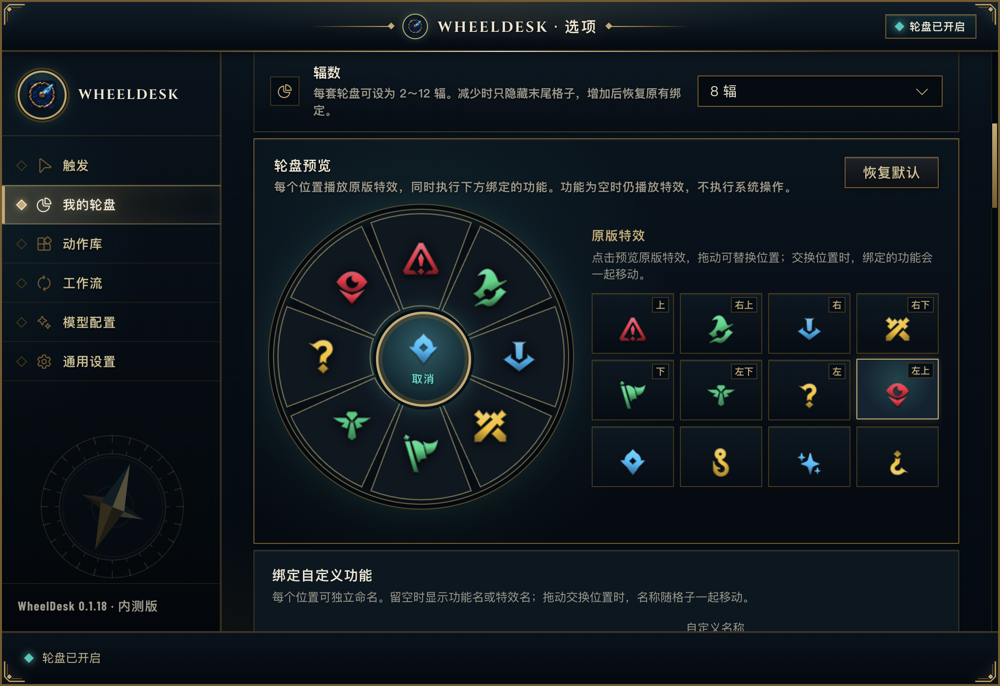
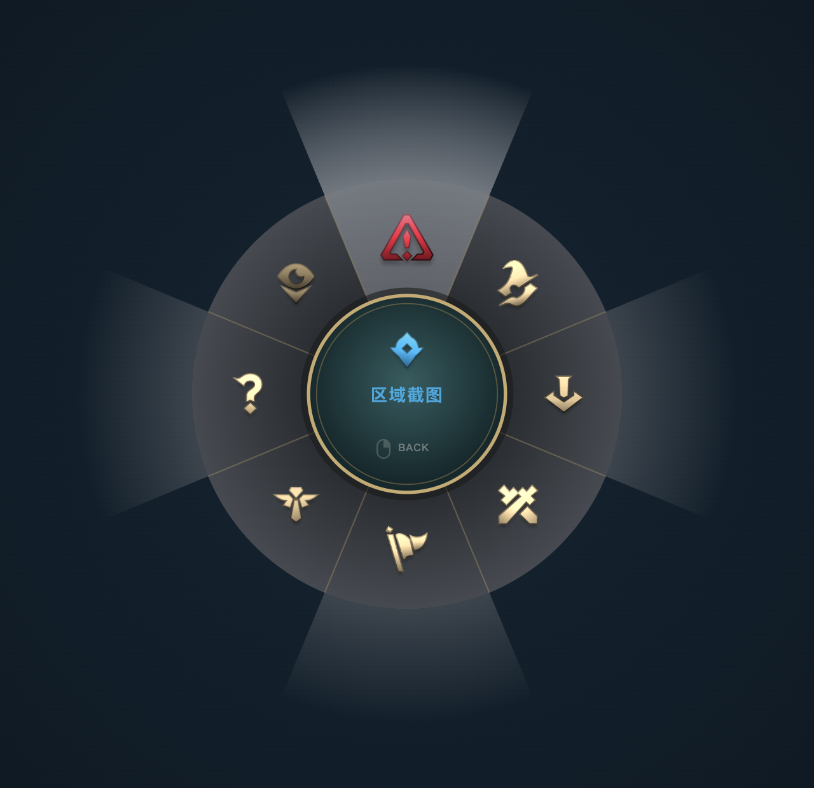
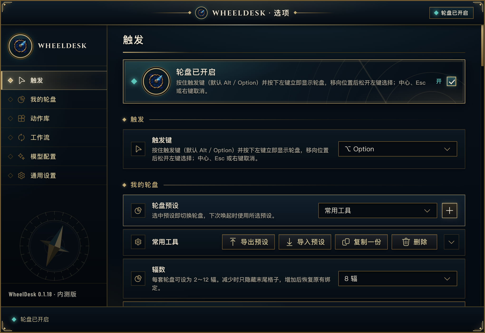
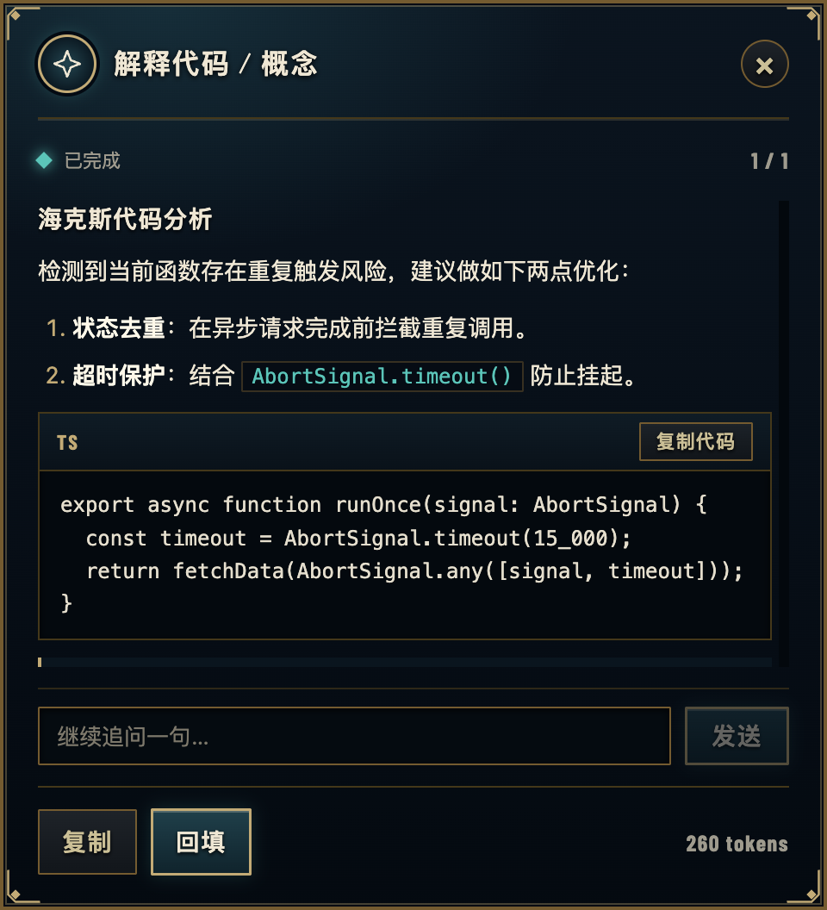

# WheelDesk

[English](README.md) · [下载最新版本 (Releases)](https://github.com/Alooshy0827/WheelDesk/releases) · `v0.1.19`

用 **英雄联盟（LOL）原版信号轮盘** 的手感执行日常系统操作、AI 指令与本地工作流。按住 `Alt`（macOS 为 `Option`）并按下鼠标左键立即呼出轮盘，甩向目标槽位松开执行；回到中心、按 `Esc` 或右键取消。

基于 [lolPing](https://github.com/darrenprx/lolPing) 的 `c97fe772b98514b83f011ee540601faabd066d23` 版本开发，完整保留 MIT 许可证与原作者声明；复用原版信号贴图、动画与交互音效，独立的 Riot Games 素材版权声明见 [LICENSE](LICENSE) 与 [NOTICE.md](NOTICE.md)。不包含表情与联机房间功能。

---

## 实机预览

| 1:1 英雄联盟游戏内风格轮盘编辑器 | 桌面悬浮信号轮盘（支持 2～12 辐） |
| :---: | :---: |
|  |  |

| 游戏内选项主界面（含预设导入 / 导出） | 海克斯 AI 流式结果浮窗（Markdown · 代码复制 · 追问） |
| :---: | :---: |
|  |  |

---

## 核心特性

- **1:1 英雄联盟游戏内 UI 与交互音效**：复刻召唤师峡谷游戏内 `Esc` 选项窗口（双层古铜金属边框、四角海克斯雕花、方形勾选框、菱形滑块、离线内置 `Cinzel` & `Barlow Condensed` 字体），内置 10 个完成分级响度校准的原版 LOL UIKit 交互音效并与全局音量/静音联动。详见 [UI 设计规范](docs/ui-design-spec.md)。
- **原版轮盘特效与自定义功能解耦**：保留悬停高亮缩放、扩散光圈、弹跳浮动、All In 双侧碰撞及原版音效。每格独立绑定动作与自定义名称，支持 2～12 辐自由调节（缩减隐藏末尾、恢复保留绑定）。
- **轮盘预设一键导出 / 导入**：可将任意轮盘及其引用的动作、工作流导出为独立 `.wheeldesk.json` 分享给他人，**自动剔除模型配置与 API 密钥**；导入时自动处理 ID 冲突，不覆盖已有预设。
- **鼠标原生高频默认动作**：开箱内置区域截图、截图问答、截图提取文字（OCR）、截图翻译、中英互译、润色、总结要点、解释代码/概念、纯文本粘贴与打开目录；支持自定义「打开应用/文件/文件夹」、打开网址、复杂快捷键、剪贴板操作与本地脚本。
- **海克斯流式结果浮窗**：流式输出不抢前台焦点，支持 **Markdown 安全渲染**、**代码块一键复制**、**浮窗内多轮追问**，以及目标窗口校验后的**一键回填**；文字动作绝不静默附带截图。
- **AI 自定义动作与工作流**：兼容 OpenAI / Anthropic 接口及本地模型（Ollama / LM Studio），支持用自然语言描述需求并缓存可编辑的复用指令；支持多步骤线性工作流与 macOS Shell / Windows PowerShell 脚本（标准输入传参）。
- **隐私与本地加密**：中英文双语界面，API 密钥由系统加密存于 `secrets.enc`；无账号、无遥测、无云同步。

---

## 下载与安装

前往 [GitHub Releases](https://github.com/Alooshy0827/WheelDesk/releases) 下载对应平台安装包：

### macOS 13+（Apple Silicon）
1. 下载 `WheelDesk-0.1.19-arm64.dmg`，打开后将 `WheelDesk.app` 拖入「应用程序」。
2. 应用使用固定证书签名（未做 Apple 公证）；如首次启动被拦截，在「系统设置 → 隐私与安全性」中选择「仍要打开」。
3. 打开 WheelDesk → **通用设置** → 授予 **辅助功能** 权限后输入助手会自动连接（仅截图动作需要 **屏幕录制** 权限）。

### Windows 11（x64）
1. 下载 `WheelDesk-Setup-0.1.19.exe` 运行安装向导即可（首次运行如遇 SmartScreen 提示，点击「更多信息 → 仍要运行」）。

---

## 快速上手

1. **配置模型**：在「模型配置」点击「＋」，选择厂商预设（支持 OpenAI、Anthropic、DeepSeek、阿里云百炼/通义千问、Kimi、Gemini、Ollama、LM Studio 及自定义），填入密钥、选择模型后点击「保存并测试连接」。
2. **定制轮盘**：在「我的轮盘」选择辐数（2～12 辐），拖动原版特效调整位置，下方为每格绑定功能与自定义名称；点击「导出预设 / 导入预设」即可分享或导入社区轮盘包。
3. **AI 自定义动作**：在槽位下方点击「新建 AI 自定义动作」，填写自然语言描述并点击「生成理解」（或首次使用时自动生成），后续描述不变将直接复用，省去重复解析费用。
4. **编排工作流**：先在动作库准备动作，再到「工作流」按顺序添加步骤并指定每步输入（固定内容 / 选中文字 / 剪贴板 / 手动输入 / 框选截图 / 上一步结果），之后直接在轮盘槽位中选择「工作流 · 名称」绑定。

---

## 开发与验证

需要 Node 22.12+；macOS 需 Xcode 命令行工具，Windows 需 Visual Studio 2022 C++ 构建工具。

```sh
npm ci
npx install-electron
npm run test:helper
npm run typecheck
npm test
npm run dev
npm run dist:mac
# Windows 上：
npm run dist:win
```

`tools/smoke.cjs` 使用真实 Electron 应用与本地模拟模型进行端到端检查：构建后将 `WHEELDESK_DATA_DIR` 指向临时绝对目录运行 `npm run smoke`。完整检查记录见 [验证记录](docs/validation.md)。

提交后 GitHub Actions 会在 Windows 和 macOS 上自动运行类型检查、原生助手测试、单元测试与构建。macOS 签名与备份说明见 [设计说明](docs/wheeldesk.md#stable-macos-update-identity)。

---

## 数据与隐私

配置存储于 `~/Library/Application Support/WheelDesk`（macOS）或 `%APPDATA%\WheelDesk`（Windows）。API 密钥由 Electron `safeStorage` 加密存于 `secrets.enc`，不进入普通配置，也不会包含在导出的轮盘预设中。运行结果仅保留在当前会话内存中，截图与脚本临时文件用后即删。详见 [NOTICE.md](NOTICE.md) 与 [设计说明](docs/wheeldesk.md)。
